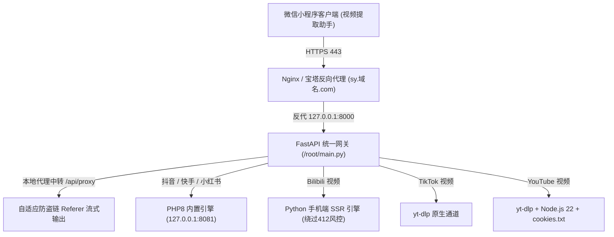

# 零成本无水印短视频/图集解析系统 · 换机迁移与一键部署手册

本文档为**「全平台无水印短视频与图集提取系统」**的完整交付与服务器迁移手册。未来更换任何 Linux 云服务器（Ubuntu 22.04 / Debian 11+）时，只需按顺序复制执行以下脚本，即可在 5~10 分钟内全自动复刻完整的后端解析与流式代理集群。

---

## 一、 系统架构总览



### 核心特性
- **0 成本**：不依赖任何收费第三方解析 API，无调用额度限制。
- **全平台支持**：抖音、快手、小红书（单视频/多图集）、B站、TikTok、YouTube。
- **自适应防盗链中转**：通过 `/api/proxy` 流式直出，绕过微信小程序的下载合法域名限制与各大平台防盗链。
- **高韧性风控穿透**：针对 B 站海外 IP 触发的 412 风控与 YouTube 机器人拦截做了专用解算加固。

---

## 二、 换新机一键部署指南（分步执行）

> [!IMPORTANT]
> 推荐新服务器操作系统：**Ubuntu 22.04 LTS (x86_64)**。
> 全程使用 `root` 用户登录 SSH 终端执行。

### 步骤 1：系统基础环境与音视频工具链安装

```bash
# 1. 更新软件包索引
apt update && apt upgrade -y

# 2. 安装 Python3、pip、git、ffmpeg、curl
apt install -y python3 python3-pip git ffmpeg curl ca-certificates gnupg

# 3. 安装 Node.js 22.x（YouTube n-challenge JS挑战解算必需）
mkdir -p /etc/apt/keyrings
curl -fsSL https://deb.nodesource.com/gpgkey/nodesource-repo.gpg.key | gpg --dearmor -o /etc/apt/keyrings/nodesource.gpg
echo "deb [signed-by=/etc/apt/keyrings/nodesource.gpg] https://deb.nodesource.com/node_22.x nodistro main" | tee /etc/apt/sources.list.d/nodesource.list
apt update && apt install -y nodejs

# 4. 安装 Python 核心依赖
pip3 install fastapi uvicorn requests pydantic

# 5. 安装官方独立版 yt-dlp（自带完整解析运行环境）
curl -L https://github.com/yt-dlp/yt-dlp/releases/latest/download/yt-dlp_linux -o /usr/local/bin/yt-dlp
chmod a+rx /usr/local/bin/yt-dlp

# 6. 验证核心工具链
yt-dlp --version
node -v
ffmpeg -version | head -n 1
```

---

### 步骤 2：部署国内平台解析引擎（PHP 引擎）

支持抖音、快手、小红书（视频与高清图集）：

```bash
# 1. 创建项目目录并拉取开源解析引擎
mkdir -p /www/wwwroot
cd /www/wwwroot
git clone https://github.com/jiuhunwl/short_videos.git
cd short_videos

# 2. 补齐 PHP CLI（如果服务器没装宝塔或 PHP）
apt install -y php-cli php-curl php-json php-mbstring

# 3. 修改安全域名白名单配置（允许内部调用）
sed -i "s/\$allowPrivateHosts = false;/\$allowPrivateHosts = true;/" /www/wwwroot/short_videos/api/sv.php
sed -i "s/\$allowedHosts = \[\];/\$allowedHosts = \['127.0.0.1', '127.0.0.1:8081', 'localhost'\];/" /www/wwwroot/short_videos/api/sv.php

# 4. 创建 PHP 守护服务（运行在 127.0.0.1:8081）
cat << 'EOF' > /etc/systemd/system/shortvideos-php.service
[Unit]
Description=ShortVideos PHP Service
After=network.target

[Service]
Type=simple
User=root
WorkingDirectory=/www/wwwroot/short_videos/api
ExecStart=/usr/bin/php -S 127.0.0.1:8081 -t /www/wwwroot/short_videos/api
Restart=always
RestartSec=3

[Install]
WantedBy=multi-user.target
EOF

# 启动并开机自启
systemctl daemon-reload
systemctl enable --now shortvideos-php
systemctl status shortvideos-php --no-pager
```

---

### 步骤 3：部署核心网关与调度中心（FastAPI）

```bash
# 1. 写入主程序代码 /root/main.py
cat << 'EOF' > /root/main.py
import re
import os
import json
import subprocess
import urllib.parse
import requests
from fastapi import FastAPI, Query, HTTPException
from fastapi.responses import StreamingResponse
from fastapi.middleware.cors import CORSMiddleware
from pydantic import BaseModel

app = FastAPI(title="Video Parser API")

app.add_middleware(
    CORSMiddleware,
    allow_origins=["*"],
    allow_methods=["*"],
    allow_headers=["*"],
)

class ParseRequest(BaseModel):
    text: str

def extract_url(text: str):
    urls = re.findall(r'https?://[^\s<>"\'，。；;）)\]]+', text)
    return urls[0] if urls else None

# 通用海外视频提取器（支持 YouTube / TikTok）
def parse_ytdlp_media(raw_url: str, platform_name: str = "海外视频"):
    is_yt = any(k in raw_url for k in ["youtube.com", "youtu.be"])
    cmd = [
        "/usr/local/bin/yt-dlp",
        "--js-runtimes", "node:/usr/bin/node",
        "--no-warnings"
    ]
    if is_yt:
        cmd.extend(["--cookies", "/root/cookies.txt"])
    
    cmd.extend([
        "--print", "%(title)s",
        "--print", "%(thumbnail)s",
        "-g",
        raw_url
    ])

    env = os.environ.copy()
    env["HOME"] = "/root"
    env["PATH"] = "/usr/local/sbin:/usr/local/bin:/usr/sbin:/usr/bin:/sbin:/bin:" + env.get("PATH", "")

    res = subprocess.run(cmd, capture_output=True, text=True, timeout=40, env=env)
    if res.returncode == 0 and res.stdout:
        lines = [line.strip() for line in res.stdout.strip().split("\n") if line.strip() and not line.startswith("WARNING")]
        if len(lines) >= 3:
            title = lines[0]
            cover = lines[1]
            stream_urls = [l for l in lines[2:] if l.startswith("http")]
            video_url = stream_urls[0] if stream_urls else lines[2]
            proxy_url = f"/api/proxy?url={urllib.parse.quote(video_url, safe='')}"
            return {
                "code": 0,
                "data": {
                    "type": "video",
                    "platform": platform_name,
                    "title": title,
                    "video_url": proxy_url,
                    "cover_url": cover,
                    "images": []
                }
            }
        elif len(lines) >= 1:
            urls = [l for l in lines if l.startswith("http")]
            if urls:
                proxy_url = f"/api/proxy?url={urllib.parse.quote(urls[-1], safe='')}"
                return {
                    "code": 0,
                    "data": {
                        "type": "video",
                        "platform": platform_name,
                        "title": lines[0],
                        "video_url": proxy_url,
                        "cover_url": urls[0] if len(urls) > 1 else "",
                        "images": []
                    }
                }
    err = res.stderr.strip() if res.stderr else "未能获取媒体流"
    short_err = err.split("\n")[-1][:120]
    return {"code": 1, "message": f"{platform_name}解析失败: {short_err}"}

# B站免412风控专用解析器（手机端SSR直取）
def parse_bilibili(raw_url: str):
    headers = {
        "User-Agent": "Mozilla/5.0 (iPhone; CPU iPhone OS 16_6 like Mac OS X) AppleWebKit/605.1.15",
        "Referer": "https://m.bilibili.com/"
    }
    bv_m = re.search(r'(BV[a-zA-Z0-9]+)', raw_url)
    target_url = f"https://m.bilibili.com/video/{bv_m.group(1)}" if bv_m else raw_url
    
    resp = requests.get(target_url, headers=headers, timeout=15)
    html = resp.text
    
    title_m = re.search(r'<title>([^<]+?)(?:_哔哩哔哩|_bilibili).*?</title>', html)
    title = title_m.group(1) if title_m else "B站视频"
    
    state_m = re.search(r'window\.__INITIAL_STATE__\s*=\s*(\{.*?\});', html)
    play_url = None
    cover = ""
    
    if state_m:
        try:
            data = json.loads(state_m.group(1))
            cover = data.get("videoData", {}).get("pic", "")
            raw_str = json.dumps(data)
            urls = re.findall(r'https?://[^\"]+?\.bilivideo\.c(?:om|n)[^\"]*', raw_str) or re.findall(r'https?://[^\"]+?\.mp4[^\"]*', raw_str)
            if urls:
                play_url = urls[0].replace('\\/', '/')
        except Exception:
            pass

    if not play_url:
        clean_html = html.replace(r'\u002F', '/').replace(r'\/', '/')
        urls = re.findall(r'https?://[^\",\s]+?\.bilivideo\.c(?:om|n)[^\",\s]*', clean_html)
        if urls:
            play_url = urls[0]

    if not play_url:
        return {"code": 1, "message": "未能提取到B站播放流"}
        
    proxy_url = f"/api/proxy?url={urllib.parse.quote(play_url, safe='')}"
    return {
        "code": 0,
        "data": {
            "type": "video",
            "platform": "B站",
            "title": title,
            "video_url": proxy_url,
            "cover_url": cover,
            "images": []
        }
    }

@app.post("/api/parse")
def parse_video(req: ParseRequest):
    raw_url = extract_url(req.text)
    if not raw_url:
        return {"code": 1, "message": "未找到有效链接"}

    # 1. 直链 MP4 快速通道
    if raw_url.lower().endswith(".mp4"):
        return {
            "code": 0,
            "data": {
                "type": "video",
                "platform": "直链",
                "title": "直链视频",
                "video_url": f"/api/proxy?url={urllib.parse.quote(raw_url, safe='')}",
                "cover_url": "",
                "images": []
            }
        }

    # 2. 视频号友好提示（平台保护）
    if "weixin.qq.com" in raw_url:
        return {
            "code": 1,
            "message": "视频号采用微信底层加密且严控爬虫，为防小程序被封禁，建议在电脑微信使用嗅探工具提取。"
        }

    # 3. YouTube 专属解析通道
    if any(k in raw_url for k in ["youtube.com", "youtu.be"]):
        try:
            return parse_ytdlp_media(raw_url, "YouTube")
        except Exception as e:
            return {"code": 1, "message": f"YouTube解析异常: {str(e)}"}

    # 4. TikTok 专属解析通道
    if "tiktok.com" in raw_url:
        try:
            return parse_ytdlp_media(raw_url, "TikTok")
        except Exception as e:
            return {"code": 1, "message": f"TikTok解析异常: {str(e)}"}

    # 5. B站免拦截通道
    if any(k in raw_url for k in ["bilibili.com", "b23.tv", "b23"]):
        try:
            return parse_bilibili(raw_url)
        except Exception as e:
            return {"code": 1, "message": f"B站解析异常: {str(e)}"}

    # 6. 抖音、快手、小红书走本地 PHP 引擎 (127.0.0.1:8081)
    if any(k in raw_url for k in ["xhs", "xiaohongshu"]):
        php_api_path = "xiaohongshu/xhsjx.php"
        platform_name = "小红书"
    elif any(k in raw_url for k in ["kuaishou", "gifshow", "kwai"]):
        php_api_path = "kuaishou/ksjx.php"
        platform_name = "快手"
    elif any(k in raw_url for k in ["douyin", "iesdouyin"]):
        php_api_path = "douyin/douyin.php"
        platform_name = "抖音"
    else:
        return {"code": 1, "message": "未识别该平台链接，请尝试抖音、快手、小红书、B站、TikTok或YouTube"}

    try:
        php_url = f"http://127.0.0.1:8081/{php_api_path}?url={urllib.parse.quote(raw_url)}"
        headers = {
            "Host": "sy.sd0739.top",
            "User-Agent": "Mozilla/5.0 (iPhone; CPU iPhone OS 16_6 like Mac OS X) AppleWebKit/605.1.15"
        }
        resp = requests.get(php_url, headers=headers, timeout=25)
        res = resp.json()

        if res.get("code") == 200 or res.get("code") == 0:
            data = res.get("data", {})
            origin_video_url = data.get("url") or data.get("video") or ""
            images = data.get("images") or []
            
            proxy_url = ""
            if origin_video_url:
                proxy_url = f"/api/proxy?url={urllib.parse.quote(origin_video_url, safe='')}"

            images = [img if isinstance(img, str) else img.get("url", "") for img in images]

            return {
                "code": 0,
                "data": {
                    "type": "images" if (not origin_video_url and images) else "video",
                    "platform": platform_name,
                    "title": data.get("title") or data.get("desc") or "提取成功",
                    "video_url": proxy_url,
                    "cover_url": data.get("cover") or (images[0] if images else ""),
                    "images": images
                }
            }
        else:
            return {"code": 1, "message": res.get("msg") or "解析失败，请检查链接"}
    except Exception as e:
        return {"code": 1, "message": f"解析异常: {str(e)}"}

# 流式代理中转（自适应多平台中转）
@app.get("/api/proxy")
def proxy_stream(url: str = Query(..., description="目标媒体直链")):
    try:
        headers = {
            "User-Agent": "Mozilla/5.0 (Windows NT 10.0; Win64; x64) AppleWebKit/537.36 (KHTML, like Gecko) Chrome/120.0.0.0 Safari/537.36"
        }
        if "bilivideo" in url:
            headers["Referer"] = "https://www.bilibili.com/"
            headers["User-Agent"] = "Mozilla/5.0 (iPhone; CPU iPhone OS 16_6 like Mac OS X) AppleWebKit/605.1.15"
        elif "xhscdn" in url or "xiaohongshu" in url:
            headers["Referer"] = "https://www.xiaohongshu.com/"
            headers["User-Agent"] = "Mozilla/5.0 (iPhone; CPU iPhone OS 16_6 like Mac OS X) AppleWebKit/605.1.15"
        elif "kuaishou" in url or "gifshow" in url:
            headers["Referer"] = "https://www.kuaishou.com/"
            headers["User-Agent"] = "Mozilla/5.0 (iPhone; CPU iPhone OS 16_6 like Mac OS X) AppleWebKit/605.1.15"
        elif "tiktok" in url or "byteoversea" in url:
            headers["Referer"] = "https://www.tiktok.com/"
        elif "googlevideo" in url or "youtube" in url:
            headers["Referer"] = "https://www.youtube.com/"
        else:
            headers["Referer"] = "https://www.douyin.com/"
            headers["User-Agent"] = "Mozilla/5.0 (iPhone; CPU iPhone OS 16_6 like Mac OS X) AppleWebKit/605.1.15"

        r = requests.get(url, headers=headers, stream=True, timeout=45)
        return StreamingResponse(
            r.iter_content(chunk_size=1024 * 256),
            media_type=r.headers.get("content-type", "video/mp4"),
            headers={"Content-Disposition": "inline; filename=media.mp4"}
        )
    except Exception as e:
        raise HTTPException(status_code=500, detail=str(e))

if __name__ == "__main__":
    import uvicorn
    uvicorn.run("main:app", host="0.0.0.0", port=8000, reload=False)
EOF

# 2. 创建 FastAPI 系统守护服务
cat << 'EOF' > /etc/systemd/system/videoparser.service
[Unit]
Description=Video Parser FastAPI Service
After=network.target

[Service]
Type=simple
User=root
WorkingDirectory=/root
ExecStart=/usr/local/bin/uvicorn main:app --host 127.0.0.1 --port 8000
Restart=always
RestartSec=3

[Install]
WantedBy=multi-user.target
EOF

# 3. 启动并开机自启
systemctl daemon-reload
systemctl enable --now videoparser
systemctl status videoparser --no-pager
```

---

### 步骤 4：配置 YouTube 凭据（cookies.txt）

因为海外数据中心 IP 容易被 Google 判定为机器人，必须在 `/root/cookies.txt` 中放入 YouTube Cookie：

1. 电脑 Chrome 浏览器安装插件 **「Get cookies.txt LOCALLY」**；
2. 打开 `youtube.com` 并登录任意 Google 账号；
3. 点击插件图标，点击 **Export** 导出名为 `cookies.txt`；
4. 将文件内容粘贴保存到服务器 `/root/cookies.txt`：
   ```bash
   cat << 'EOF' > /root/cookies.txt
   # 此处粘贴你导出的 Netscape 格式 cookies 内容
   EOF
   chmod 600 /root/cookies.txt
   ```

---

### 步骤 5：Nginx 域名反向代理与 HTTPS 配置

以宝塔面板或原生 Nginx 为例：
1. **DNS 解析**：在域名解析后台（Cloudflare / 阿里云等）将二级域名（例如 `sy.sd0739.top`）添加 A 记录指向服务器新 IP。
2. **Nginx 配置反代**：
   在宝塔新建站点 `sy.sd0739.top`，或者在 `/etc/nginx/conf.d/` 中添加：
   ```nginx
   server {
       listen 80;
       server_name sy.sd0739.top;

       location / {
           proxy_pass http://127.0.0.1:8000;
           proxy_set_header Host $host;
           proxy_set_header X-Real-IP $remote_addr;
           proxy_set_header X-Forwarded-For $proxy_add_x_forwarded_for;
           proxy_set_header X-Forwarded-Proto $scheme;
           
           # 大文件流式代理中转优化
           proxy_buffering off;
           proxy_read_timeout 300s;
       }
   }
   ```
3. **申请 Let's Encrypt SSL 证书**：
   - 宝塔用户：在站点属性 -> SSL -> 点击「申请免费证书」；
   - 原生 Linux 用户：运行 `certbot --nginx -d sy.sd0739.top`。

---

## 三、视频号解析服务（2026-11-07 已验证）

### 1. 服务架构

视频号解析使用独立的 Go 服务，不额外配置域名或 Nginx：

```text
微信小程序
  → https://sy.sd0739.top/api/parse
  → FastAPI /root/main.py（127.0.0.1:8000）
  → wx-video-channel-download（127.0.0.1:2022）
  → 腾讯元宝解析 + finder.video.qq.com 媒体源
```

- 项目目录：`/opt/wx-video-channel-download`
- systemd 服务：`wx-video-channel.service`
- 监听地址：`127.0.0.1:2022`，仅 VPS 本机可访问
- 源码版本：`oliver-zch/wx-video-channel-download`，部署基线提交 `baf68f2`
- 配置文件：`/opt/wx-video-channel-download/config.yaml`
- 元宝 Cookie 需要包含完整的 `hy_user`、`hy_token` 等字段；Cookie 过期后需重新登录并更新

### 2. 已应用的兼容修复

原项目会清除视频 URL 的部分查询参数，并且请求腾讯视频 CDN 时未携带必要请求头，会导致媒体代理返回 HTTP 400。当前 VPS 已做两项修复：

1. `internal/service/sph.go` 的 `CleanVideoURL` 保留完整 HTTPS URL 和全部查询参数；
2. `internal/service/decryptor.go` 请求 CDN 时添加微信移动端 `User-Agent`、`Referer`、`Origin` 和 `Accept`，同时继续传递 `Range`。

源码修改后使用以下流程重新编译：

```bash
cd /opt/wx-video-channel-download
gofmt -w internal/service/sph.go internal/service/decryptor.go
go build -o wx-video-channel-download.new .
systemctl stop wx-video-channel.service
mv wx-video-channel-download wx-video-channel-download.previous
mv wx-video-channel-download.new wx-video-channel-download
chmod 755 wx-video-channel-download
systemctl start wx-video-channel.service
```

### 3. FastAPI 接入点

`/root/main.py` 和本地 `server/main.py` 已加入：

- `parse_wechat_channels()`：调用 `http://127.0.0.1:2022/api/parse`；
- 视频号域名判断：识别 `weixin.qq.com` 和 `channels.weixin.qq.com`；
- `/api/wechat_proxy`：把视频流转发给小程序，支持 HTTP Range；
- 代理只接受 `https://*.qq.com` 媒体地址，避免作为任意地址代理使用；
- `origin_url` 同样指向本站代理，避免客户端下载未经解密的源文件。

### 4. Cookie 更新

在电脑浏览器登录 `yuanbao.tencent.com`，从开发者工具 Network 请求的 Request Headers 中复制完整 `Cookie`。不得只复制某一个 Cookie 值，也不要将 Cookie 发到聊天或写入终端历史。

更新 `/opt/wx-video-channel-download/config.yaml` 中的 `sph_cookie` 后执行：

```bash
chown wxsph:wxsph /opt/wx-video-channel-download/config.yaml
chmod 600 /opt/wx-video-channel-download/config.yaml
systemctl restart wx-video-channel.service
```

检查配置时只检查字段名称，不输出值：

```bash
python3 - <<'PY'
import yaml
with open('/opt/wx-video-channel-download/config.yaml', encoding='utf-8') as f:
    cookie = str(yaml.safe_load(f).get('sph_cookie') or '')
names = {x.split('=', 1)[0].strip() for x in cookie.split(';') if '=' in x}
print('Cookie 字段数:', len(names))
print('包含 hy_user:', 'hy_user' in names)
print('包含 hy_token:', 'hy_token' in names)
PY
```

### 5. 健康检查与故障定位

```bash
# 两个后端服务状态
curl -sS http://127.0.0.1:2022/api/status
systemctl status wx-video-channel.service --no-pager -l
systemctl status videoparser.service --no-pager -l

# 日志
journalctl -u wx-video-channel.service -n 50 --no-pager
journalctl -u videoparser.service -n 50 --no-pager
```

已验证的正确结果：解析接口返回标题、作者、封面和 H264 地址；媒体代理对 `Range: bytes=0-1023` 返回 `206`、`Content-Type: video/mp4` 和有效的 `Content-Range`。

常见故障：

| 现象 | 原因与处理 |
| :--- | :--- |
| `sph_cookie 未配置` | 更新配置后服务尚未重启，执行 `systemctl restart wx-video-channel.service` |
| `generalToken is empty` | Cookie 不完整或已过期，重新复制包含 `hy_user`、`hy_token` 的完整 Cookie |
| 解析成功但所有字段为空 | 上游没有真正解析成功，检查 Cookie 和服务日志 |
| 2022 代理返回 400 | 检查完整 URL 参数和 CDN 请求头兼容修复是否仍在 |
| 8000 代理返回 502 | 先直接测试 2022 的 `/api/proxy`，再检查 `main.py` 的 `/api/wechat_proxy` |

> 更新或重新克隆开源项目后，必须重新确认上述两个源码兼容修复仍然存在；直接覆盖 `/root/main.py` 也会丢失 FastAPI 视频号接入代码。

---

## 四、 微信小程序端配置与发布注意事项

### 1. 接口地址配置
在小程序代码 `miniprogram/pages/video-helper/video-helper.js` 第 4 行确认：
```javascript
const PARSE_SERVER_API = 'https://sy.sd0739.top/api/parse'
```

### 2. 小程序后台合法域名配置（上线审核前必配）
登录 [微信公众平台 (mp.weixin.qq.com)](https://mp.weixin.qq.com)：
- 进入 **开发管理 -> 开发设置 -> 服务器域名**；
- 在 `request合法域名` 中添加：`https://sy.sd0739.top`
- 在 `downloadFile合法域名` 中添加：`https://sy.sd0739.top`

> [!NOTE]
> 为什么只用填这一个域名？  
> 因为我们所有外部平台（抖音、快手、小红书、B站、TikTok、YouTube）的视频下载流全部通过 `/api/proxy?url=...` 由你自己的服务器统一代理中转，微信客户端只需要信任你自己的这一个二级域名，彻底免去了配置几十个各大厂动态 CDN 域名的烦恼！

### 3. 上线过审安全策略建议
- **前端界面去敏感词**：前端界面徽标保持为国内合规标签（【抖音】【小红书】【快手】【B站】等）。不要在小程序界面出现「YouTube」等涉外平台大图标，以防微信机审或人工审核驳回。
- **后台接口全兼容**：后台 `main.py` 保留 YouTube 与 TikTok 的全量解析通道。用户在小程序输入框粘贴 YouTube 或 TikTok 链接时，后台会自动静默识别并秒级解析成功，既合规又功能齐全！

---

## 五、 常用运维命令速查表

| 操作需求 | 命令 |
| :--- | :--- |
| 查看主调度服务运行状态 | `systemctl status videoparser` |
| 重启主调度服务 | `systemctl restart videoparser` |
| 实时查看主服务日志 | `journalctl -u videoparser -f -n 50` |
| 查看视频号服务状态 | `systemctl status wx-video-channel.service --no-pager -l` |
| 重启视频号服务 | `systemctl restart wx-video-channel.service` |
| 查看视频号服务日志 | `journalctl -u wx-video-channel.service -f -n 50` |
| 测试视频号服务健康状态 | `curl -sS http://127.0.0.1:2022/api/status` |
| 查看 PHP 引擎运行状态 | `systemctl status shortvideos-php` |
| 重启 PHP 引擎 | `systemctl restart shortvideos-php` |
| 测试 YouTube 本地直连 | `yt-dlp --js-runtimes node:/usr/bin/node --cookies /root/cookies.txt -g "https://youtu.be/dJon-OgBaXU"` |
| 测试国内抖音解析 | `curl "http://127.0.0.1:8081/douyin/douyin.php?url=https://v.douyin.com/1ESyUrkxwOQ/"` |

---

## 六、图片局部修复

小程序页面 `pages/image-repair/image-repair` 支持本地选图、解析图集带图进入、矩形框选和画笔涂抹。后端接口为：

- `POST /api/image/inpaint`：接收图片文件和画布遮罩，使用 OpenCV Telea 修复；
- `GET /api/image/result?id=...`：返回保存 24 小时的 JPG 结果；
- 单张上传最大 15MB，最大解码像素约 3600 万；
- 仅处理本人或已获授权的图片。

服务器依赖：

```bash
pip3 install python-multipart opencv-python-headless numpy
mkdir -p /root/image_repairs
python3 -m py_compile /root/main.py
systemctl restart videoparser.service
```

Nginx 站点配置需允许图片上传，在 `server` 或对应 `location /` 内加入：

```nginx
client_max_body_size 20m;
proxy_read_timeout 180s;
```

修改后执行 `nginx -t && systemctl reload nginx`。微信公众平台“服务器域名”还需把 `https://sy.sd0739.top` 同时配置为 `request`、`uploadFile` 和 `downloadFile` 合法域名。

---

## 七、意见反馈与通知

“我的 → 意见反馈”使用自定义弹窗，提交到 `POST /api/feedback`，并始终保存到 SQLite 的 `feedback` 表。管理员数据接口 `/api/admin/data` 会返回最近 200 条反馈。

通知为可选配置：

- 邮件：设置 `FEEDBACK_SMTP_HOST`、`FEEDBACK_SMTP_PORT`、`FEEDBACK_SMTP_USER`、`FEEDBACK_SMTP_PASSWORD`、`FEEDBACK_EMAIL_TO`；
- 微信提醒：个人微信没有官方机器人收信接口，可配置企业微信群机器人地址 `FEEDBACK_WECOM_WEBHOOK`；
- 通知发送失败不影响数据库保存，可在服务器后台继续查看。

建议把环境变量写入 `videoparser.service` 的 `[Service]` 段，执行 `systemctl daemon-reload && systemctl restart videoparser.service` 生效。SMTP 密码和企业微信 Webhook 不得写入小程序前端代码。

---

## 八、CDN 防护绕过与小程序下载控制机制（2026-11-07 升级）

### 1. 腾讯云 EdgeOne / CDN 567 报错绕过机制
- **问题**：B站 CDN（如 `upos-sz-mirrorcosov.bilivideo.com`）等平台启用了腾讯云 EdgeOne / WAF 边缘防爬策略，对于无 Range 分片头的流式代理请求会直接拦截并返回 HTTP 567（`请求已被站点的安全策略拦截`）。
- **解法**：在 `/root/main.py` 的 `/api/proxy` 流式代理中，将请求头注入 `headers["Range"] = request.headers.get("range") or "bytes=0-"`，并对应透传 HTTP 206 / 200 响应，完美伪装为常规媒体播放器请求，解除 EdgeOne 防护阻断。

### 2. 小程序端沉浸式下载进度与「停止下载」机制
- **问题**：原生微信小程序 `wx.downloadFile` 如果使用 `wx.showLoading({ mask: true })`，会在下载长视频（如 69 分钟、上百 MB 的高清视频）时导致界面完全死锁，用户无法取消。
- **解法**：
  1. **移除死锁遮罩**：去除侵入性全局 loading 蒙层，引入带有实时进度百分比、动态绿色进度条、已下载/总计 MB 大小的居中悬浮卡片；
  2. **秒级停止下载**：保存 `currentDownloadTask` 句柄，点击【停止下载】时调用微信底层的 `currentDownloadTask.abort()` 瞬间中断网络流并释放系统资源与手机内存；
  3. **页面退出自动防漏**：页面销毁（`onUnload`）时自动中止未完成的下载任务，杜绝后台偷跑流量；
  4. **大视频后台续传指引**：针对微信小程序原生不支持断点续传（pause/resume）的限制，弹窗内置贴心提示，引导超大视频用户可停止后一键「复制下载链接」，在手机浏览器（Safari / Chrome）中后台断点续传。

---

## 九、审计日志与数据保留（2026-11-07）

### 1. 操作审计日志

本地 `server/main.py` 新增 SQLite 表 `audit_logs`，后台左侧新增“操作日志”，最多展示最近 500 条并支持按用户 ID、动作或详情搜索。记录范围：

- 新用户首次进入；
- 提取成功与失败；
- 用户兑换卡密；
- 管理员增加、减少或设置额外次数；
- 设置/取消不限次状态、禁用、解禁和重置用户。

审计详情不得记录完整卡密、Cookie、密码、SMTP 授权码或 Webhook。

### 2. 数据保留规则

VPS 当前使用独立模块 `/root/retention_feature.py`，由 `/root/main.py` 末尾调用 `install_retention_feature(...)`。服务启动时立即清理一次，之后每 6 小时执行一次：

- `/root/videos` 与 `/root/image_repairs` 中超过 24 小时的临时文件自动删除；
- SQLite 的 `parse_logs`、`audit_logs`、`feedback` 中超过 30 天的记录自动删除；
- `users`、用户额度、卡密和权益状态不参与自动清理；
- 邮箱或企业微信中已经发送的反馈通知副本不属于 SQLite 自动清理范围。

小程序“清空历史记录”只清除手机本地历史，不删除服务器日志。服务器不向普通用户开放日志删除接口，日志统一按 30 天规则自动清理。

### 3. 运维检查

```bash
# 查看自动清理日志
journalctl -u videoparser.service -n 100 --no-pager \
  | grep -E '\[cleanup\]|Application startup'

# 检查模块和主程序语法
python3 -m py_compile /root/main.py /root/retention_feature.py
```

成功标志：服务启动日志出现 `[cleanup] removed files=..., records=...`，并且 `/api/user/delete_records` 不再出现在公开路由中。

### 4. 升级注意

更新 `/root/main.py` 前必须同时确认下列能力仍在：

- 视频号 `parse_wechat_channels()` 与 `/api/wechat_proxy`；
- 审计日志 `audit_logs`；
- 文件末尾仍调用 `install_retention_feature(...)`；
- `/root/retention_feature.py` 未被删除。

禁止使用来源不明的旧版 `curl ... -o /root/main.py` 直接覆盖生产文件。更新前执行：

```bash
cp -a /root/main.py /root/main.py.backup-$(date +%Y%m%d-%H%M%S)
cp -a /root/retention_feature.py /root/retention_feature.py.backup-$(date +%Y%m%d-%H%M%S)
```
